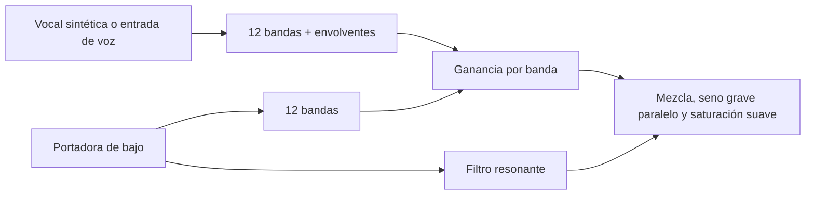

# Extender filtros y añadir vocoders

Investigación 2026-10-09 / BVC-07 / EXP-057. La primera implementación está en
[020 — bajos y vocoder](../experiments/020-bajos-vocoder/README.md).

## Tres rutas

| Ruta | Uso | Estado |
| --- | --- | --- |
| DSP dentro de una fuente Lua | Procesar un instrumento antes de mezclar voces, con controles propios | Implementado en 020; host pendiente |
| Custom Lua Effect / Lua Effect | Procesar audio o coordenadas de la cadena de efectos | Efecto de dos entradas preparado en 020; ruteo en host pendiente |
| osci-render VST/AU dentro de una DAW | Encadenar efectos y rutear una voz/micrófono a un vocoder | Documentado; no se instaló ni configuró una DAW |

La [documentación oficial del proyecto](https://github.com/jameshball/osci-render)
confirma fuentes/efectos Lua y versiones standalone, VST y AU. La revisión del
código local no encontró un cargador de efectos VST de terceros dentro del
standalone; no se presupone que arrastrar cualquier VST sobre él funcione.

### Evidencia de tu copia local

- `../osci-render/Source/PluginProcessor.h`, parámetro `customEffectStrength`:
  Lua Effect con editor y nivel de aplicación, código inicial `return {x,y,z}`.
- `../osci-render/Source/components/lua/LuaDocumentationComponent.cpp`:
  `sample_rate`, `slider_a…slider_z`, `ext_x/ext_y`; para efectos, `x/y/z`.
- `../osci-render/Source/audio/synth/ShapeVoice.cpp` asigna a `ext_x/ext_y` las
  muestras del buffer de entrada antes de ejecutar una fuente Lua.
- `../osci-render/Source/PluginProcessor.cpp` copia entrada al buffer incluso
  en la ruta de síntesis. `inputEnabled` activa otra ruta que sustituye la
  síntesis por el audio de entrada: no debe activarse para el bajo Lua de 020.

Esto verifica la interfaz en código. La recepción de micrófono en tu dispositivo,
la UI de sliders del efecto y el rendimiento real aún deben probarse en Pro.
Los efectos globales procesan la señal mezclada; para afectar únicamente al bajo,
el DSP se inserta en esa voz o se separan pistas en la DAW.

## Qué implementamos

Un filtro de vocales mueve resonancias para imitar a/e/i/o/u. Un vocoder de banco
de filtros analiza el modulador y usa sus envolventes para gobernar las mismas
regiones de la portadora. La implementación nueva realiza ese análisis por muestra.

El banco cubre 90–5500 Hz; el extremo alto se adapta a la tasa. Cada banda tiene
dos biquads en cascada, Q=2.6, ataque 6 ms y caída 70 ms. Los coeficientes de
pasabanda/pasabajos siguen el [Audio EQ Cookbook del W3C](https://www.w3.org/TR/audio-eq-cookbook/).
El bajo agrega dos sierras PolyBLEP, filtro de cuatro polos, fundamental senoidal
y eliminación de DC. La saturación suave limita la amplitud pero puede generar
aliasing; no es un compresor con ataque/release ni un limitador con anticipación.

La biblioteca es independiente del repertorio. Podemos extenderla con más bandas,
noise/unvoiced, desplazamiento de formantes, oversampling o portadoras derivadas
de superficies, después de evaluar esta prueba. No están implementados todavía.
Un sidechain de volumen como el del host sólo mide amplitud general; no reemplaza
este análisis espectral. Filtrar X/Y modifica el dibujo y deja de conservar F=0.

## Ruta por Live

Si tu edición incluye Vocoder: poner osci-render en la pista de la portadora y
Vocoder en una pista de voz. En Vocoder elegir Carrier **External**, seleccionar
la pista de osci-render y **Post FX**. Así el bajo aporta la afinación y la voz
aporta articulación. Live permite ajustar bandas, ataque/release y sonidos sordos;
consultar su [manual oficial, Vocoder](https://www.ableton.com/en/live-manual/12/live-audio-effect-reference/#vocoder).
No se comprobó que tu Live instalado arranque ni se guardó una sesión.

REAPER también puede alojar la cadena de instrumento/efectos y rutear audio;
la configuración concreta del vocoder elegido sigue pendiente. Para explorar
el motor nuevo no hace falta instalarlo: los presets Lua tienen modulador sintético.
