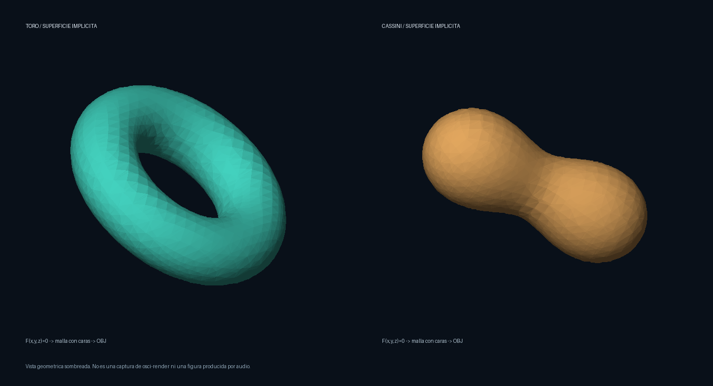

# EXP-019 — Superficies algebraicas, no curvas aisladas

Corrección del objetivo indicada por el usuario: visualizar la superficie como
tal. Esta prueba extrae mallas triangulares desde ecuaciones implícitas, sin
usar una única parametrización de curva como sustituto de la superficie.



La imagen es una **vista 3D sombreada de las mallas**, no salida de un osciloscopio.
Los mismos triángulos están en `toro.obj` y `cassini.obj`, listos para probar su
importación en osci-render. Allí se espera representación vectorial; no el relleno
sombreado de esta imagen. No hemos verificado aún esa importación en la aplicación.

## Ecuaciones

- Toro: `(x²+y²+z²+R²−r²)²−4R²(x²+y²)=0`, con `R=0.62`, `r=0.24`.
- Superficie de Cassini: `(x²+y²+z²+a²)²−4a²x²−b⁴=0`, con `a=0.60`, `b=0.65`.
  Es la superficie de producto constante de distancias a dos focos; aquí forma
  un cuerpo conectado con estrechamiento central.

Son superficies cuárticas. Se extraen en `[-1.12,1.12]³` con una grilla de 28
celdas por eje, subdividida en tetraedros. Se refinan los vértices sobre `F=0`
usando su gradiente. Las caras planas siguen siendo una aproximación de la
superficie; residuo pequeño en vértices no implica error cero en toda la cara.

## Verificación

| Modelo | Vértices | Caras | Característica de Euler |
| --- | ---: | ---: | ---: |
| Toro | 3784 | 7568 | 0 |
| Cassini | 2558 | 5112 | 2 |

Cada arista tiene dos caras incidentes, no se detectan triángulos degenerados y
el residuo máximo de `F` en vértices es inferior a `1e-9`. La orientación se
contrasta con el gradiente. Estas comprobaciones no sustituyen un análisis de
error geométrico ni garantizan extracción correcta de cualquier polinomio.
El programa implementa estos dos campos concretos; aún no acepta ecuaciones libres.

```sh
python3 scripts/build_implicit_surfaces.py
```

Regenera ambos OBJ, la vista y un informe local `validacion.json`. Pillow ya está
disponible en este equipo. Los OBJ y la imagen son ejemplos de referencia
versionados; el informe generado queda fuera de Git.

## Prueba en osci-render y siguiente paso

Abrir `toro.obj` con el selector de archivos y rotarlo; luego probar `cassini.obj`.
Empezar con volumen bajo y revisar la densidad: miles de aristas pueden requerir
una malla simplificada o una estrategia de barrido distinta para obtener una
imagen y un sonido útiles. No hay una composición musical nueva asociada a esta prueba.

La aceptación final requiere reconocer la superficie en el host y compararla
con esta vista. Después vendrán deformaciones de coeficientes y relación con
fraseo/ritmo de las referencias musicales. El resultado actual es geometría
estática completa y exportable; la integración musical sigue pendiente.
